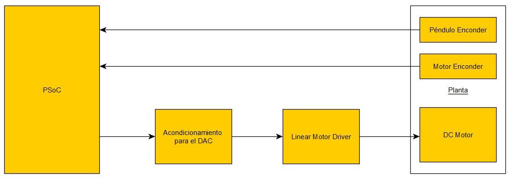
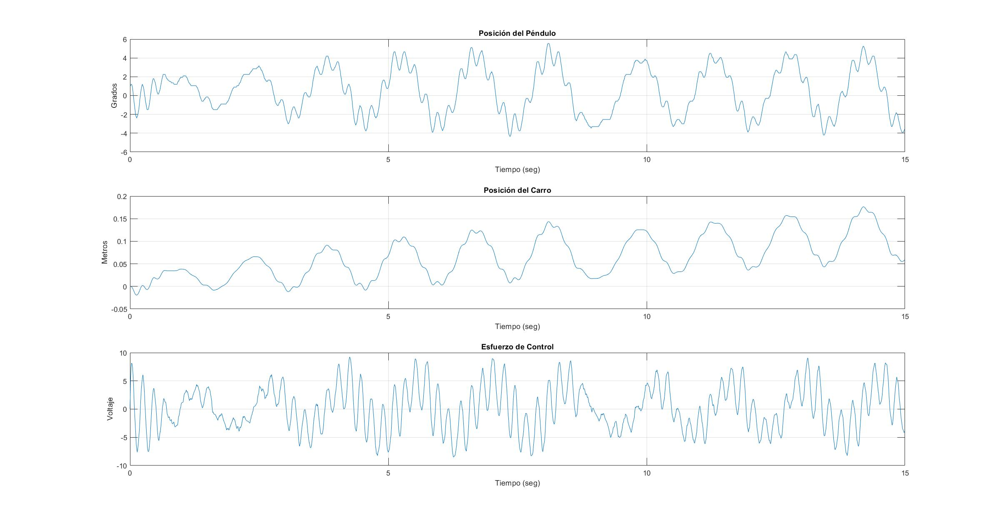

# Inverted Pendulum on a Cart: Eight Control Methods on a PSoC 5LP

Course project for *Automation* (Electronic Engineering, Universidad Católica "Nuestra
Señora de la Asunción", Paraguay, 2022). Supervisor: Prof. Enrique Vargas.
Authors: **Federico Morán** and **Daniel Barboza**.

We modelled a cart-and-pendulum rig, designed eight controllers in MATLAB, ported them to C
by hand on a PSoC 5LP (ARM Cortex-M3), and compared each run on the rig against its
simulation. Not all of them worked, and the table below says why.

The full report (Spanish, 27 pages) is in [`report/TPF-Moran-Barboza.pdf`](report/TPF-Moran-Barboza.pdf).



## The rig

- Pendulum on a cart that runs on a rail. A DC motor moves the cart through a belt.
- Two quadrature encoders: one on the motor shaft (cart position), one on the pendulum
  pivot (angle).
- The PSoC drives the motor through two 8-bit DACs (one per polarity), a conditioning stage
  to ±10 V and a linear power driver (op-amp with a complementary transistor output stage).

| Parameter | Value |
|---|---|
| Pendulum mass (with a tennis ball as bob) | 0.1493 kg |
| Cart mass | 0.2275 kg |
| Distance to pendulum centre of mass | 0.1825 m |
| Motor torque constant *K<sub>m</sub>* | 0.17776 |
| Rotor inertia *J<sub>m</sub>* | 2.23 × 10⁻⁴ |
| Viscous friction *B<sub>m</sub>* | 1.1751 × 10⁻³ |
| Armature resistance *R<sub>a</sub>* | 9.10 Ω |
| Armature inductance *L<sub>a</sub>* | 6.12 mH |
| Angle resolution | 0.15° per encoder count |
| Cart resolution | 0.6° per count on an 18.1 mm pulley radius |

The motor parameters were measured in the lab. Motor connector pinout: 1 motor −,
2 encoder supply, 3 encoder phase A, 4 encoder phase B, 5 encoder ground, 6 motor +.

## Results

| # | Method | Report § | Firmware | *T*<sub>s</sub> | On the rig |
|---|---|---|---|---|---|
| 1 | PID with filtered derivative | 4.1 | [`01_pid`](firmware/01_pid) | 1 ms | Balanced with about 1° of error. Lost control under large disturbances. |
| 2 | Root-locus compensator | 4.2 | [`02_root_locus`](firmware/02_root_locus) | 1 ms | Balanced for small errors. Control effort at the limit of the actuator. |
| 3 | Frequency-domain lead compensator (w-plane) | 4.3 | see note below | 1 ms | Stable, but with a steady-state error. It never fully settled. |
| 4 | Pole placement with integral action | 5.1 | [`03_pole_placement`](firmware/03_pole_placement) | 10 ms | Stable and recovered from disturbances with reasonable effort. |
| 5 | Prediction estimator | 5.2 | [`04`](firmware/04_prediction_estimator), [`05`](firmware/05_prediction_estimator_integral) (with integrator) | 10 ms | Held upright for long periods. Smoother cart motion. |
| 6 | Current estimator | 5.3 | [`06`](firmware/06_current_estimator), [`07`](firmware/07_current_estimator_integral) (with integrator) | 10 ms | **Best result.** Stable, and recovered quickly after pushes. |
| 7 | LQR | 5.4 | [`08_lqr`](firmware/08_lqr), [`09_lqr_current_estimator`](firmware/09_lqr_current_estimator) | 10 ms | **Did not work.** The gains needed more than the ±10 V the actuator could give. |
| 8 | Steady-state Kalman filter | 5.5 | [`10_kalman`](firmware/10_kalman) | 10 ms | Smoother and more robust to noise, but did not hold the pendulum for long. |

Classical methods (1 to 3) only feed back the pendulum angle, so the cart drifts toward the
ends of the rail. State-feedback methods (4 to 8) also control the cart position, which kept
it centred with much less control effort.

The measured runs behind the report figures are in [`data/`](data) and the plots in
[`figures/`](figures). This is the current estimator on the rig:



**Note on method 3.** There is no separate firmware folder for the frequency-domain design.
Its compensator is a second-order difference equation of the same form as the root-locus
one, and alternative coefficient sets are left commented out in
[`02_root_locus/main.c`](firmware/02_root_locus/main.c). Its measured run is
[`data/datos_bode.mat`](data/datos_bode.mat).

## What we would do differently

- **LQR.** With the control weight at `Q2 = 0.001` and a weight of 1000 on cart velocity,
  the optimiser treated control effort as almost free. The gains came out around
  `[-1940 3770 3355 1714]`, against `[-533 -215 465 86]` for our hand-placed poles. We tried
  several weightings on the rig (they are in `08_lqr` and `09_lqr_current_estimator`) and
  none fitted in ±10 V. We should have simulated with actuator saturation and raised the
  control weight before going to hardware.
- **Anti-windup.** Every variant resets its integrator and estimator states when the
  computed control signal exceeds a threshold (20 to 400 depending on the variant). Since
  that is always above the ±10 V the output can deliver, it works as a "pendulum fell"
  detector, not as anti-windup. Clamping or back-calculation would be the right fix.
- **Model per pendulum mass.** Two of the estimator variants (`07` and `10`) keep two sets
  of *A* and *B* matrices, one for a plumb bob and one for a tennis ball, because the plant
  changed when we changed the bob.

## How the firmware works

All variants share the same structure:

1. A timer interrupt sets a flag at the sample rate.
2. The main loop reads both quadrature decoders, converts counts to radians and metres,
   computes the control signal and writes it to the DACs, clamped to ±10 V.
3. The state-space variants run the estimator in single-precision floating point (the
   Cortex-M3 in the PSoC 5LP has no FPU, so this is software float).
4. Over UART, `I` resets the encoders and states and starts the loop, and `P` stops it and
   sets the output to 0 V (in the two estimator variants without integrator, only `I` is
   implemented). Every cycle the firmware prints `u, angle, position` as CSV. We captured
   it with a terminal and plotted it with
   [`matlab/telemetry/graficar_serial.m`](matlab/telemetry/graficar_serial.m).

## Repository layout

```
firmware/        one PSoC Creator project per controller: main.c, schematic
                 (TopDesign.cysch), pin assignment (Lab2.cydwr), project file
matlab/          design and simulation scripts, one per method (TP_*.m)
matlab/barboza/  Daniel Barboza's scripts: motor model, root locus, frequency design
matlab/telemetry/ plotting scripts and an example of raw UART capture
data/            measured runs (.mat): td, pendulo, carro, esfuerzo
figures/         measured and simulated plots used in the report, diagrams
report/          full report (Spanish)
```

Files with `_v2` or `_v3` in the name are later iterations of the same script.

## Building

**Firmware.** PSoC Creator 4.4 with ARM GCC 5.4 (2016-q2). Open `Lab2.cyprj` in the folder of the
controller you want. Three files the project expects are not in this repository because
they are not ours:

- `debug.c` and `common.h` retarget `printf` to the UART. They come from a Cypress code
  example and are distributed under Cypress's license. Copy them from any PSoC 5LP UART
  code example in PSoC Creator.
- `cyapicallbacks.h` is an empty file that PSoC Creator creates for every new project.

Generated sources are rebuilt by PSoC Creator on the first build.

**MATLAB.** Needs the Control System Toolbox. `TP_ubicacion_arbitratia_polos.m` calls
`refi.m`, the reference-input function from Franklin, Powell and Workman, *Digital Control
of Dynamic Systems*, which is not included. The scripts still contain absolute Windows
paths from the machine we used, and their comments are in Spanish (Latin-1 encoding).
